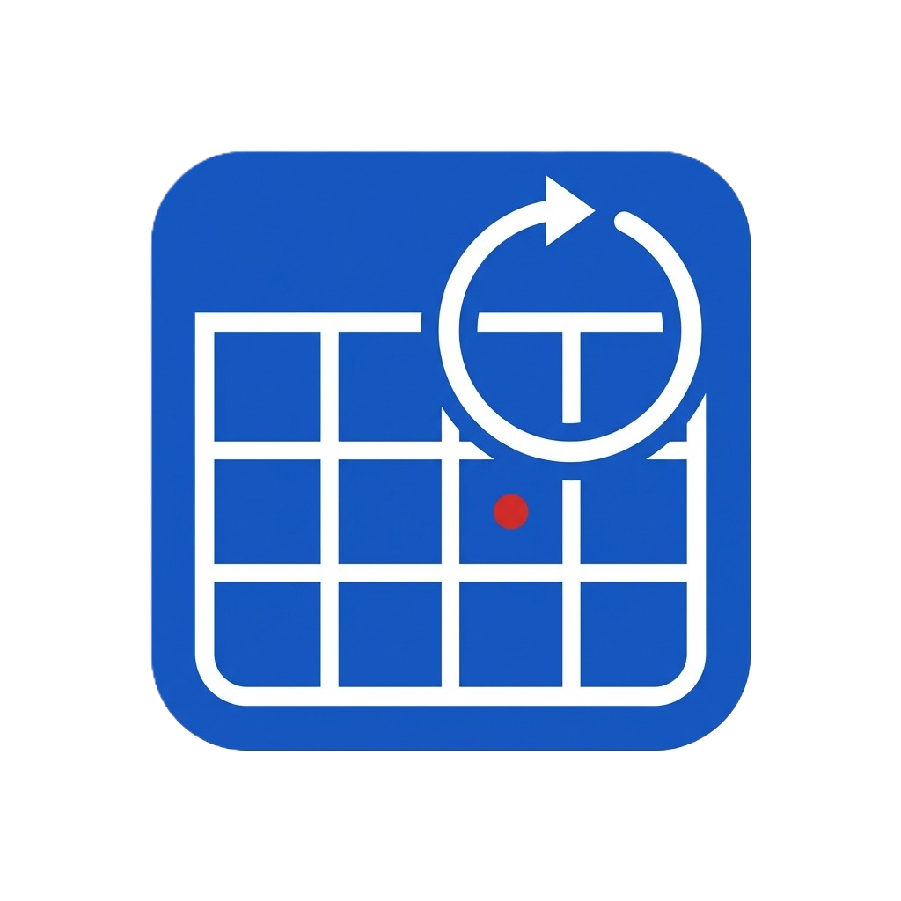

# Semestria

**Schulnetz-Prüfungen und Termine automatisch in Outlook.**

---

Semestria liest Prüfungen, Schultermine und den Stundenplan aus dem persönlichen Schulnetz-iCal-Feed und zeigt sie im Kalender der App, auf Wunsch auch in Outlook. Dazu kommen Aufgaben mit Erinnerung und ein Notenbereich, der Schnitt, Pluspunkte und Promotion ausrechnet, bis hin zur Matur- oder BM-Note. Alles bleibt lokal auf deinem Gerät, mit einem eigenen Profil pro Person.

## Screenshots

<b>Dashboard</b> Stand des letzten Abgleichs, die Zahlen des Semesters, was als Nächstes ansteht und der Stundenplan von morgen.

<table>
<tr>
<td width="50%"> 
<b>Wochenansicht</b> der Stundenplan als Raster. Prüfungen rot, Termine orange, jedes Fach in seiner eigenen Farbe.</td>
<td width="50%"> 
<b>Monatsansicht</b> der ganze Monat auf einen Blick, volle Tage mit "+N mehr".</td>
</tr>
<tr>
<td width="50%"> 
<b>Aufgaben</b> nach Fach gruppiert, mit Abgabe und Erinnerung. Wichtiges steht zuoberst.</td>
<td width="50%"> 
<b>Einrichtung</b> fünf Schritte, bis der Feed läuft. Outlook ist dabei freiwillig.</td>
</tr>
</table>

**[Alle Screenshots ansehen](Pictures/README.md)**

## Features

- 📅 Stundenplan, Prüfungen und Schultermine direkt aus dem Schulnetz-iCal, ausgefallene Lektionen durchgestrichen
- ✏️ Eigene Einträge im Kalender, jederzeit bearbeitbar
- 🗓️ Optional: Prüfungen und Termine in Outlook via Microsoft Graph
- ✅ Aufgaben mit Listen, Abgabedatum und Erinnerung
- 🎓 Noten pro Semester oder Schuljahr, Promotionsregeln (Kanti Aarau, IMS Aarau oder eigene), Zielrechner und Abschluss mit Matur- bzw. BM-Prüfungsnoten
- 👥 Mehrere Profile auf einem PC, jedes mit eigenen Daten und eigener Microsoft-Anmeldung
- 🧭 Kurze Anleitung auf jeder Seite, alle wieder abrufbar unter «Hilfe»
- 🔒 Alles lokal: Feed-URL verschlüsselt (Windows DPAPI), keine Telemetrie, kein Konto
- 🖥️ Läuft im Hintergrund als System-Tray-App

## Download

**[→ Semestria im Microsoft Store](https://apps.microsoft.com/detail/9NJV8F0X7XMZ)**

Alternativ: `.msix`-Datei unter [Releases](../../releases) (Sideloading erforderlich).

Datenschutz und Nutzungsbedingungen: [docs/policy.html](docs/policy.html)

## Tech Stack

| | |
|---|---|
| UI | WPF · .NET 9 · ModernWpfUI |
| Logik | .NET 8 Core-Bibliothek, xUnit-Tests |
| Kalender | Microsoft Graph API v5 · MSAL |
| iCal | Ical.Net 5 |
| Sicherheit | DPAPI (lokale Verschlüsselung) |
| Distribution | MSIX · Microsoft Store |

## Changelog

Ausführliche Notizen zu den einzelnen Arbeitstagen liegen unter
[Session Summary](Session%20Summary/).

### 26.10.2026 (v3.1)

- [x] Profilbild: im Profilmenü ein eigenes Bild wählen oder entfernen
- [x] Profilfeld neu: Bild links, Name und «Profil wechseln» daneben
- [x] IMS-Vorlage: höchstens 3 Minuspunkte, keine Mindestnote in Informatik mehr (eigene Mindestnoten weiterhin möglich)
- [x] Nach einem Update startet Semestria erst neu, wenn Windows die neue Version installiert hat

### 24.10.2026 (v3.0)

**Noten**
- [x] Neuer Bereich «Noten»: Noten mit Gewicht (0.25, 0.5, 1 …) eintragen, Fachnoten auf halbe Noten gerundet
- [x] Semester und Schuljahre als Tabs, neue beginnen, alte löschen
- [x] Promotionsregel zuerst wählen: Vorlagen Kanti Aarau (Matur) und IMS Aarau (BM) oder eigene Regel
- [x] Zielrechner: welche Note die nächste Prüfung braucht
- [x] Abschluss: Matur- bzw. BM-Noten aus Zeugnis- und Prüfungsnoten, mit Prüfungsziel

**Kalender**
- [x] Ausgefallene Lektionen grau, durchgestrichen und mit «Ausfall»-Badge
- [x] Eigene Einträge bearbeiten
- [x] Schultermine werden standardmässig nicht mehr nach Outlook geschrieben

**Profile**
- [x] Mehrere Profile auf einem PC, Wechsel oben links mit einem Klick
- [x] Jedes Profil mit eigenen Daten und eigener Microsoft-Anmeldung
- [x] Outlook-Termine sind pro Profil markiert, kein Profil ändert die Termine eines anderen

**Hilfe und Nachrichten**
- [x] Kurze Anleitung auf jeder Seite, Überblicks-Rundgang beim ersten Start, Seite «Hilfe»
- [x] Nachrichten und Umfrage-Links vom Entwickler, frühestens ab dem 4. Start, abschaltbar
- [x] Nutzungsbedingungen und Datenschutzerklärung Version 2.0, Zustimmung vor dem ersten Laden

*Summary: Das grösste Update bisher. Semestria ist vom Kalender-Sync zum Schulbegleiter geworden, mit Noten, Profilen und Anleitungen. Getestet mit 293 automatischen Tests, darunter die Rechenbeispiele der Alten Kanti Aarau und der IMS Aarau.*

### 17.09.2026 (v2.2)
- [x] Dashboard neu: Stundenplan, Kennzahlen, Aufgaben, einklappbares Protokoll
- [x] Einrichtung neu, inkl. Hinweis auf schulNetz.mobile
- [x] Kalender: Kopfleiste aufgeräumt, Fachkürzel statt voller Titel
- [x] Farben: 28 Farben, Farbmischer, einzelne Stunden und Termine färbbar
- [x] Kommentare pro Fach
- [x] Aufgaben: eigene Listenfarben, neues Design, Uhrzeiten wie getippt
- [x] Link zum Synapkey-Dashboard in der Seitenleiste
- [x] Standard neu: dunkles Design, nur Prüfungen nach Outlook
- [x] Fix: Absturz des Dashboards ab dem 18. Oktober (Zeitumstellung)
- [x] Fix: blaue Kachel hinter dem Taskleisten-Icon

### 04.09.2026
- [x] Outlook-Kalender-Integration (Microsoft Graph)
- [x] Titel kürzen (max. Zeichenlimit)
- [x] Filter verbessern

### 28.08.2026
- [x] Projekt geplant und Architektur definiert
- [x] iCal-Parser und Event-Klassifikation (Prüfung / Termin)
- [x] Feed-URL-Verschlüsselung mit DPAPI
- [x] App im Microsoft Store veröffentlicht

### 11.09.2026
- [x] Scroll bug beheben
- [x] Loading screen
- [x] Versions abruf um Updatebeachrichtigung zu ermöglichen (Updater)

*Summary: Beim Starten der Applikation lädt ein loading screen der Microsoft Store anfragt ob ein Update verfügbar ist um dies anzuzeigen.*

### 17.09.2026
- [x] Aufgaben Eintrag überprüfen
- [x] Listenfarbe ändern unabhängig von Stundenplan
- [x] Deeplink für meine Web-Applikation [Synapkey](https://synapkey.ch)

*Summary: Heute ist sehr viel geschehen, von Design überarbeitung bis CoreLogik änderungen. 
[Details](Session%20Summary/2026-09-17-v2.2.md)*